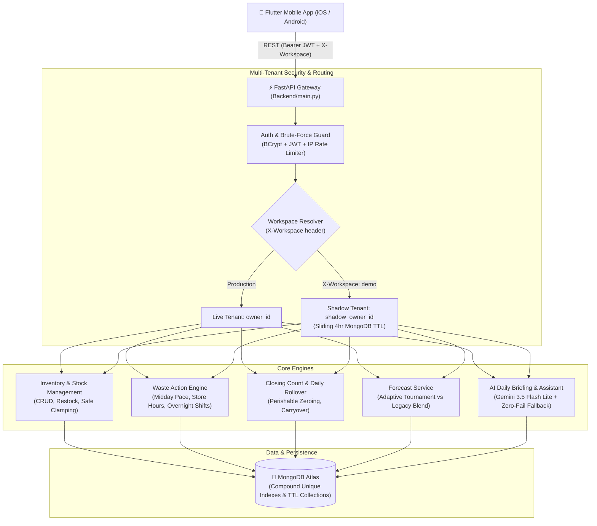

# RestockIQ 🥐📉

[](file:///E:/CAP/APP/test)
[](file:///E:/CAP/Backend)
[](file:///E:/CAP/APP)
[](https://restockiq-backend.onrender.com/health)

**RestockIQ** is an end-to-end, AI-powered inventory forecasting, waste-reduction, and demand optimization platform built specifically for non-technical cafe, bakery, and local retail owners.

By hiding advanced predictive modeling behind a frictionless, **"Warm Tech"** mobile interface, RestockIQ translates complex demand forecasts into plain-language daily bake and restock orders. It doesn't just predict tomorrow's sales; it actively manages today's unsold stock with automated, real-time waste mitigation alerts, dynamic discounts, and intelligent product bundling.

---

## 🏗️ System Architecture

RestockIQ is built on a modern, decoupled asynchronous microservice architecture designed for instant mobile responsiveness, strict multi-tenant isolation, and zero-fail availability.



---

## 🌟 Key Platform Capabilities

### 1. Multi-Tenant Isolation & Zero Data Leakage
* **Strict Universal Scoping**: Every database operation in MongoDB (`items`, `daily_sales`, `daily_stock`, `forecasts`, `waste_alerts`) is scoped by `{"owner_id": current_user["_id"]}`. Cross-tenant leakage is physically impossible.
* **Brute-Force & Anti-Abuse Protection**:
  * 5 consecutive failed login attempts trigger an automatic **15-minute account lockout**.
  * Reverse-proxy safe IP rate limiting inspects `X-Forwarded-For` right-to-left to defend against header spoofing.
* **Data Integrity Guards**: Client `PUT` operations cannot tamper with ML fields (`predictedDemand` and `safetyStock` are stripped). Intraday sales and restocks enforce strictly positive quantities (`gt=0`).

### 2. Dual-Workspace Shadow Sandbox (`X-Workspace: demo`)
RestockIQ features an ephemeral, server-backed **Demo Sandbox** allowing risk-free evaluations:
* Requests with `X-Workspace: demo` are mapped to `shadow_{owner_id}` without touching live store items.
* **Sliding 4-Hour TTL**: All shadow documents carry an `expiresAt` timestamp automatically renewed on every demo interaction across all collections.
* **Atomic Purge**: Exiting the demo or calling `DELETE /api/v1/demo` immediately purges all shadow records.
* **Clock Simulation**: Demo accounts can simulate time progression to test midday pace calculations and midnight rollovers without waiting for real-world hours.

### 3. Dual Demand Forecasting Architecture

RestockIQ supports two production-grade forecasting paradigms:

#### A. Adaptive Real-Time Tournament (`adaptive_forecast.py`)
A pure-Python (zero heavy dependencies, zero pandas/numpy in API process) tournament model evaluated per item:
* **5 Competing Candidates**:
  1. Last observed sale
  2. $\text{EWMA} (\alpha = 0.5)$
  3. 7-Day Moving Average (MA7)
  4. Same-Weekday average (SWD, up to 4 historical weeks)
  5. 60/40 Weekday + MA7 Blend
* **Strict Leakage Guard**: Candidates evaluate **strictly** prior historical dates (`$lt: for_date`). Peeking into the future or current business date is blocked.
* **Bayesian Shrinkage**: Sparse or cold-start items shrink toward category priors using credibility weight $w = \frac{n}{n + K}$ ($K=1$).
* **5% Churn Margin Guard**: MA7 is favored on ties; alternative candidates must beat MA7's rolling MAE by at least 5% to prevent noisy day-to-day forecast churn.
* **Safe Fallback**: Any unexpected engine failure immediately falls back to legacy benchmarks, guaranteeing an HTTP 200 response.

#### B. Batch Machine Learning Engine (`ML/batch_forecast.py` & `ML/engine.py`)
* **Tier 1 (Staples $\ge 10$ units/day, $\ge 28$ days)**: Facebook Prophet decomposition (capturing day-of-week seasonality, trend, and holidays) pooled into a global `HistGradientBoostingRegressor` to correct non-linear interactions. Out-of-sample **~22.75% WAPE**.
* **Tier 2 (Sparse & Erratic Items)**: TSB (Teunter-Syntetos-Babai) intermittent demand model with category prior shrinkage.
* **Calendar Continuity**: History pipeline builds a full 90-day calendar grid, padding missing days with 0 and filtering exclusively for completed closing counts.

### 4. Midday Waste Action Engine
Forecasting prevents *tomorrow's* waste; the Waste Action Engine protects *today's* revenue:
* **Real-Time Pace Metric**:
  $$\text{Pace} = \frac{\text{Sold So Far}}{\text{Forecast Demand} \times \text{Elapsed Operating Fraction}}$$
* **Operating Hours & Overnight Shift Support**: Alerts calculate accurately across standard hours and overnight shifts (e.g., 22:00 to 06:00 across midnight) and automatically suppress when the store is closed.
* **Automated Mitigation Actions**:
  * **Critical Alert (Red)**: Pace $< 0.5$ on perishable stock. Recommended markdown discount (e.g., 20% off).
  * **Low Pace Alert (Amber)**: Pace between $0.5$ and $0.8$.
  * **Dynamic Bundling**: Pairs a slow-moving item with a fast-moving partner item ($\text{Pace} \ge 1.0$) with positive stock.
  * **Atomic Application**: Prevents race conditions and double discounts using atomic `{"discountApplied": {"$ne": True}}` MongoDB filters.

### 5. AI Daily Briefing & Assistant
* Powered by Google GenAI (`gemini-3.5-flash-lite`).
* **Deterministic Rule-Based Fallback**: If the network is down or API limits are reached, the system falls back to a deterministic rule-based generator. The mobile client receives a clear, factual briefing without crashes.
* **Token Efficiency**: 10-minute caching layer and zero LLM calls for empty stores.

---

## 📊 Proven Business Impact (Simulation)

To validate the forecasting and restock engine, a 90-day discrete-event inventory simulation was conducted on real bakery retail data (68,908 observed demand units across 35 SKUs from July to September 2022).

**Ordering Policy:** $\text{Restock} = \text{Forecast} + z \times \sigma_{\text{demand}}$

| Strategy ($z = 1.65$) | Total Waste (Units) | Waste % | Stockout Units | Stockout Rate | Gross Profit (€) |
| :--- | :---: | :---: | :---: | :---: | :---: |
| **Same-Weekday 4-Wk Avg** | 46,986 | 41.2% | 1,780 | 2.58% | €25,921.33 |
| **Seasonal Naive (Lag 7)** | 46,044 | 40.5% | 1,345 | 1.95% | €26,626.08 |
| **7-Day Moving Average** | 45,894 | 40.4% | 1,258 | 1.83% | €26,867.65 |
| **RestockIQ (Hybrid Model)** | **40,954** | **37.6%** | **979** | **1.42%** | **€29,042.96** |

**Impact Highlights:**
* At $z = 1.65$, RestockIQ reduces **5,090 units of food waste** and avoids **366 stockout units** compared to baseline (+€2,416.88 in 90 days).
* For lean zero-waste targets ($z = 0.0$), waste drops to **9.0%** (5,814 units) with **€40,717 in gross profit**. Full sensitivity analysis across $z \in \{0.0, 0.5, 1.0, 1.65\}$ is documented in [`docs/simulation_report.md`](file:///E:/CAP/docs/simulation_report.md).

---

## 🧪 Comprehensive Testing & Verification

RestockIQ is backed by an automated test suite verifying security, state transitions, mathematical correctness, and real-database multi-tenant isolation.

| Test Category | Suite File | Tests | Status |
|---|---|:---:|:---:|
| **Flutter Static Analysis** | `flutter analyze` | — | ✅ **0 Issues** |
| **Flutter Unit & Widget Tests** | `APP/test/widget_test.dart` | 46 | ✅ **46 / 46 Passed** |
| **Backend P0 Fixes & Security** | `Backend/test_p0_fixes.py` | 13 | ✅ **13 / 13 Passed** |
| **Tenant Isolation & Security** | `Backend/test_tenant_isolation.py` | 4 | ✅ **4 / 4 Passed** |
| **Adaptive Forecasting Engine** | `Backend/test_adaptive_forecast.py` | 13 | ✅ **13 / 13 Passed** |
| **Adaptive Integration & Fallback** | `Backend/test_adaptive_integration.py` | 5 | ✅ **5 / 5 Passed** |
| **Demo Sandbox & Shadow Tenants** | `Backend/test_demo_sandbox.py` | 20 | ✅ **20 / 20 Passed** |
| **Timezone & Waste Alerts** | `Backend/test_timezone_and_alerts.py` | 4 | ✅ **4 / 4 Passed** |
| **Lifecycle & Daily Rollover** | `Backend/test_acceptance_lifecycle.py` | 6 | ✅ **6 / 6 Passed** |
| **Backend Hardening & Audits** | `Backend/test_final_hardening.py` | 5 | ✅ **5 / 5 Passed** |
| **Total Automated Tests** | — | **124** | ✅ **100% Passing** |

---

## 📁 Repository Structure

```
CAP/
├── APP/                           # Flutter mobile client (Dart, Provider, "Warm Tech" UI)
│   ├── lib/                       # Clean architecture: models, providers, screens, services, theme, widgets
│   ├── test/                      # 46 automated unit, widget, and integration tests
│   └── README.md                  # Frontend development guide & screen specifications
├── Backend/                       # FastAPI asynchronous microservice (Motor, MongoDB Atlas, JWT)
│   ├── adaptive_forecast.py       # Pure-Python 5-candidate adaptive tournament demand engine
│   ├── main.py                    # API routing, auth, inventory lifecycle, demo sandbox & waste alerts
│   ├── services/                  # LLM service (Gemini 3.5 Flash Lite + deterministic fallback)
│   ├── venv/                      # Dedicated Python 3.10 virtual environment
│   ├── test_*.py                  # 78 backend unit, isolation, and integration test suites
│   ├── Dockerfile                 # Render container specification
│   └── README.md                  # Backend API documentation
├── ML/                            # Demand forecasting batch engine (Prophet + GBDT & Bayesian TSB)
│   ├── batch_forecast.py          # Nightly batch forecast pipeline with completed-count filtering
│   ├── engine.py                  # GBDT and benchmark forecasting inference routines
│   ├── models/                    # Serialized Prophet and GBDT models
│   └── README.md                  # Machine learning architecture documentation
├── docs/                          # Engineering reports, presentations, and verification logs
│   ├── review/                    # Independent code audit findings and walkthroughs
│   ├── simulation_report.md       # 90-day retail inventory simulation results
│   └── LIVE_DEMO_MASTER_SCRIPT.md # Step-by-step presentation script for live demo
├── scripts/                       # Database seeding, backtesting, and staging test utilities
├── render.yaml                    # Infrastructure-as-Code specification for Render deployment
└── README.md                      # Master project documentation
```

---

## 🚀 Quickstart & Local Setup

### Prerequisites
* **Flutter SDK**: 3.24+ (Dart 3.5+)
* **Python**: 3.10+
* **MongoDB**: Atlas cluster URI or local instance

### 1. Backend Service
```bash
cd Backend
# Create virtual environment
python -m venv venv
# Activate virtual environment
# Windows:
.\venv\Scripts\activate
# Linux/macOS:
source venv/bin/activate

# Install dependencies
pip install -r requirements.txt

# Run all 78 automated backend tests
python -B -m unittest discover -s . -p "test*.py"

# Start development server
uvicorn main:app --reload --port 8000
```

### 2. Mobile App (Flutter)
```bash
cd APP
# Fetch dependencies
flutter pub get

# Run static analysis
flutter analyze

# Run all 46 mobile tests
flutter test --no-pub

# Launch application
flutter run
```

### 3. Build Production Android APK
```bash
cd APP
flutter build apk --release
# Output: build/app/outputs/flutter-apk/app-release.apk
```

---

## ☁️ Cloud Deployment

The backend is deployed on Render at `https://restockiq-backend.onrender.com`.

* **Liveness Probe**: `GET /health` returns `{ "status": "ok" }`.
* **Database Ping**: `GET /health/details` (requires `JOB_SECRET`).
* **Keep-Alive**: `.github/workflows/keepalive.yml` pings the health endpoint every 10 minutes to prevent container spin-down.

---

*RestockIQ — Eliminating retail food waste and maximizing profitability through intelligent, accessible AI.*
