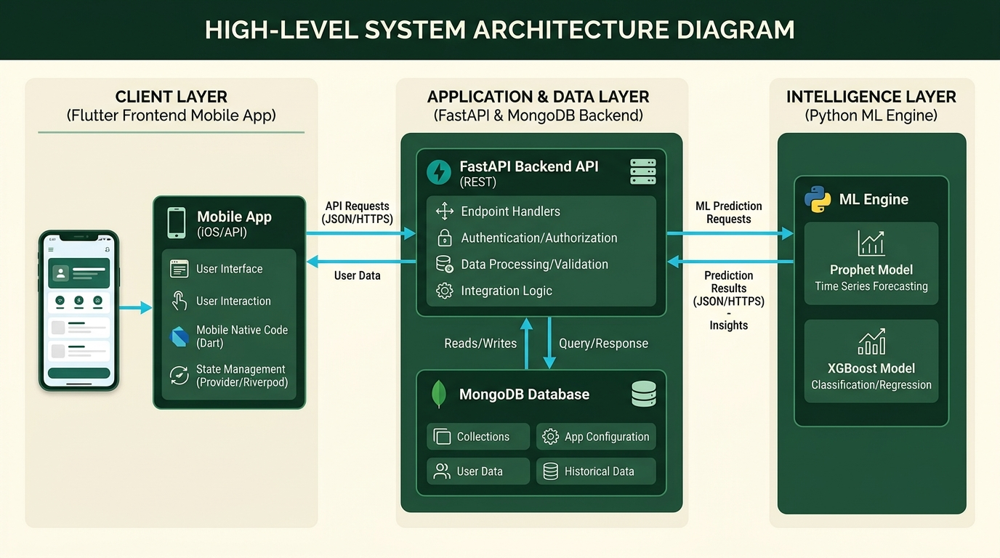
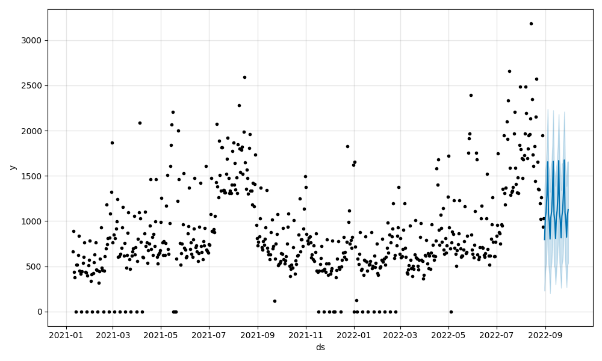
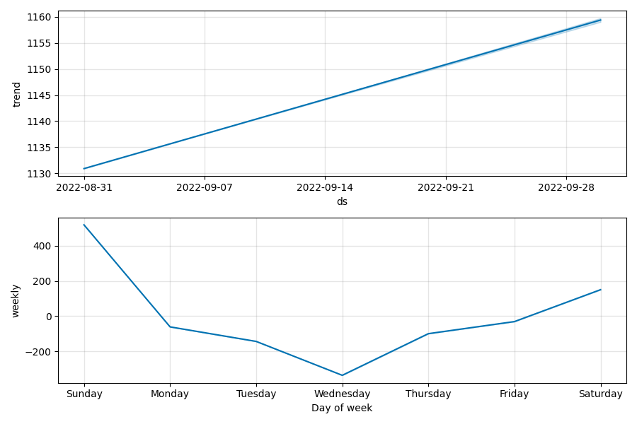

# RestockIQ 🥐📉

**RestockIQ** is an end-to-end, AI-powered inventory forecasting and waste-reduction platform built specifically for non-technical cafe, bakery, and local retail owners. 

By hiding advanced Machine Learning (Prophet + Gradient Boosting) behind a frictionless, "Warm Tech" mobile interface, RestockIQ translates complex demand forecasts into plain-language daily restock quantities. It doesn't just tell you what to order; it tells you what to do with unsold food today to maximize revenue and eliminate waste.

---

## 🏗️ High-Level Architecture

RestockIQ is built on a decoupled, batch-driven architecture designed for high-availability read speeds on mobile devices.



### 1. The Frontend (Flutter)
*   **Tech Stack:** Flutter, Dart, Firebase Auth.
*   **Design System:** **"Warm Tech"**. Off-white cream bases, deep forest greens, soft radii, and plain-language LLM explanations to minimize "math anxiety" for kitchen staff.
*   **Core Loop:** Owners check the dashboard in the morning for their exact restock/bake list, and perform a fast end-of-day check-in at closing. The app locks perishables to `0` automatically at EOD.

### 2. The Backend (FastAPI + MongoDB)
*   **Tech Stack:** Python, FastAPI, MongoDB.
*   **Role:** Acts as an ultra-fast read-layer. It does *not* execute ML inference on the fly. It reads pre-computed, structured JSON documents from MongoDB generated by the ML batch jobs.
*   **Mock-Ready:** Engineered to easily swap between mock JSON data (for parallel UI development) and real ML data.

### 3. The Machine Learning Engine



The forecasting engine is split into a **Dual-Tier Architecture** to handle both high-volume staples (croissants) and highly sparse, erratic items (specialty cakes).

#### Tier 1: Primary Items (>10 units/day)
*   **Methodology:** Prophet Decomposition + Pooled Global Gradient Boosting.
*   **How it works:** We use Facebook Prophet strictly as a feature extractor (capturing trend, weekly seasonality, country-specific holidays, and tourist seasons). Those components are fed into a single, globally pooled `HistGradientBoostingRegressor` alongside rolling lags. The trees correct Prophet's rigid mathematical overshoots using the pooled cross-item history.
*   **Performance:** Achieves a **~22.75% WAPE** on out-of-sample data, beating 7-Day Moving Averages by ~9 points and Seasonal Naive by ~12 points.



#### Tier 2: Sparse Items (<10 units/day & New Items)
*   **Methodology:** TSB (Teunter-Syntetos-Babai) + Actuarial Credibility Weighting.
*   **How it works:** Sparse retail data is zero-inflated (sells 0 most days, spikes occasionally). Standard Mean+Std breaks down here. We use the **90th percentile** of the category's daily history as a prior. As an item gains history, we fade from the category prior to the item's TSB forecast using $W = n / (n + k)$, where $k$ is calibrated to the category's volatility.
*   **Performance:** Halves the Mean Absolute Error (MAE) compared to flat category baselines (0.67 vs 1.41).

---

## 📊 Proven Business Impact (Simulation)

To validate the ML engine, we ran a 90-day inventory simulation on real bakery retail data (68,908 observed demand units across 35 SKUs from July to September 2022). 

**Ordering Policy:** `Restock = Forecast + z * Historical Std Dev`

| Strategy ($z = 1.65$) | Total Waste (Units) | Waste % | Stockout Units | Stockout Rate | Gross Profit (€) |
| :--- | :---: | :---: | :---: | :---: | :---: |
| **Same-Weekday 4-Wk Avg** | 46,986 | 41.2% | 1,780 | 2.58% | €25,921.33 |
| **Seasonal Naive (Lag 7)** | 46,044 | 40.5% | 1,345 | 1.95% | €26,626.08 |
| **7-Day Moving Average** | 45,894 | 40.4% | 1,258 | 1.83% | €26,867.65 |
| **RestockIQ (Hybrid Model)** | **40,954** | **37.6%** | **979** | **1.42%** | **€29,042.96** |

**The Result:** At $z = 1.65$ safety stock, RestockIQ reduces **5,090 units of food waste** and cuts **366 stockout units** compared to the seasonal naive baseline (+€2,416.88 additional gross margin in 90 days). Furthermore, for operators prioritizing lean zero-waste targets, RestockIQ at $z = 0.0$ reduces waste to **9.0%** (5,814 units) with **€40,717 in gross profit**. Full sensitivity analysis across $z \in \{0.0, 0.5, 1.0, 1.65\}$ is documented in [`docs/simulation_report.md`](file:///e:/CAP/docs/simulation_report.md).

---

## 🚨 The Waste Action Engine (Intraday Markdown)

Forecasting prevents *tomorrow's* waste, but what about the food already sitting on the shelf today?

RestockIQ implements a **Waste Action Engine**. It calculates a real-time `sales_pace_ratio = actual_sales_so_far / predicted_demand_so_far`. 
If a perishable item is moving significantly slower than forecasted (e.g., `< 0.6` pace), the app fires an intraday alert recommending a specific markdown action (e.g., "Apply a 20% discount now") based on modeled price elasticity. 

---

## 📁 Repository Structure

```
CAP/
├── APP/                           # Flutter mobile client (Dart, Riverpod, Warm Tech design system)
│   ├── lib/                       # Clean architecture: models, providers, screens, services, theme, widgets
│   ├── test/                      # Automated test suites (44 tests: 21 Unit, 18 Widget, 5 Integration)
│   └── README.md                  # Frontend development guide & screen specifications
├── Backend/                       # FastAPI asynchronous microservice (Motor, MongoDB Atlas, JWT)
│   ├── services/                  # Business logic & Google Gemini 3 Flash (gemini-3-flash-preview)
│   ├── test_backend_unit.py       # Offline security, BVA, decision table & CFG basis path tests (7 suites)
│   ├── Dockerfile                 # Render cloud deployment container specification
│   └── README.md                  # API endpoints, authentication, and verification guide
├── ML/                            # Demand forecasting engine (Prophet + GBDT & Bayesian TSB)
│   ├── batch_forecast.py          # Production batch pipeline executed via GitHub Actions cron
│   ├── models/                    # Production Prophet & GBDT model architectures
│   ├── data/                      # Processed historical sales rollups & raw transaction datasets
│   ├── experiments/               # Diagnostic benchmarks, grid search, and intermittent baselines
│   └── README.md                  # ML pipeline architecture & mathematical rationale
├── docs/                          # Technical engineering & operational documentation
│   ├── architecture/              # High-level architecture plans & unsold stock domain logic
│   ├── software_testing_10slides.pptx  # 10-slide high-readability testing deck with speaker notes
│   ├── software_testing_presentation.pptx # 15-slide comprehensive testing presentation
│   ├── TESTING_AND_INTEGRITY_REPORT.md # Formal software testing & verification report (51 automated tests)
│   ├── simulation_report.md       # 90-day inventory waste & stockout financial simulation
│   └── README.md                  # Technical documentation directory index
├── Documentation/                 # Academic capstone deliverables (NMIMS MPSTME, Course 702IT0E035)
│   ├── academic-reviews/          # Formal review presentation decks (Review I, Review II, improved slides)
│   ├── literature-review/         # IEEE LaTeX manuscript, markdown surveys, and comparison matrices
│   ├── research-papers/           # Curated library of 25 reference papers (Chinmay, Soumy, Yatin)
│   ├── summaries/                 # Structured summaries, notes, and domain transcripts
│   ├── tools/                     # Slide automation scripts, pptx mergers, and raw extraction dumps
│   └── README.md                  # Academic archive index and contribution guide
├── scripts/                       # Operational automation tools (backtesting, waste simulation, dataset audit)
│   ├── build_10slides_deck.js     # Reproducible PPTX builder for 10-slide testing deck
│   ├── build_testing_deck.js      # PPTX builder for 15-slide comprehensive testing deck
│   └── README.md                  # Script catalog and execution guide
├── assets/                        # Architecture diagrams and model forecast visual assets
├── adapters/                      # LLM developer personas and prompts (Claude, Gemini, GPT-OSS)
├── .github/workflows/             # GitHub Actions CI/CD (ci.yml, nightly-forecast.yml, keepalive.yml)
├── render.yaml                    # Infrastructure-as-Code for Render backend hosting
├── PROJECT_RULES.md               # Repository engineering rules, testing mandates, and coding standards
├── VERSION                        # Semantic release version tag
└── README.md                      # Project root overview
```


## 🚀 Getting Started

**Frontend (Flutter)**
1. `cd APP`
2. `flutter pub get`
3. `flutter run`

**ML Pipeline (Python)**
1. `cd ML`
2. `python -m venv venv`
3. `source venv/bin/activate` (or `venv\Scripts\activate` on Windows)
4. `pip install -r requirements.txt` (Ensure `prophet` and `scikit-learn` are installed).

---

## ☁️ Cloud Deployment & Keep-Alive Automation

The FastAPI backend is deployed live on Render at `https://restockiq-backend.onrender.com`.

### Keep-Alive Workflow
* `.github/workflows/keepalive.yml` sends an HTTP GET request to `/health` every 10 minutes to prevent Render's free-tier container from spinning down.
* **Important Caveat on GitHub Actions Cron:**
  > GitHub Actions scheduled workflows may experience execution delays during periods of high GitHub infrastructure load. Additionally, GitHub automatically disables scheduled workflows on public or private repositories that have had no commit activity for 60 consecutive days. If inactive, simply trigger the workflow manually or push a commit.

---
*Built to make independent food retail profitable, predictable, and waste-free.*
