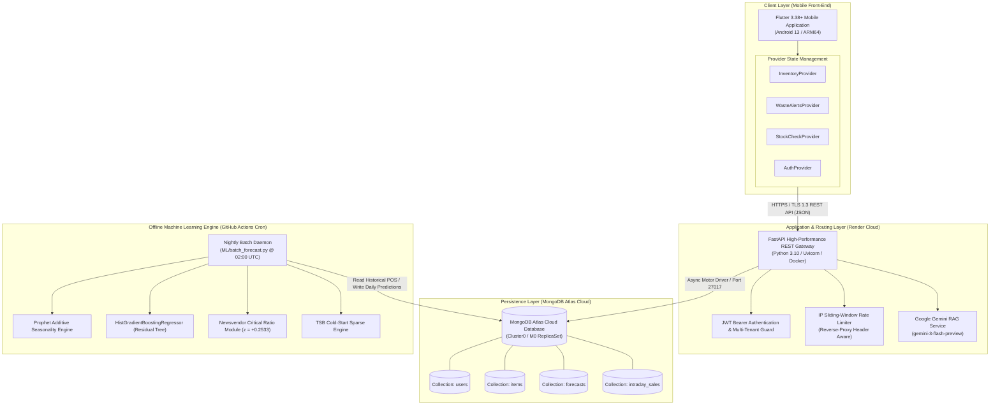
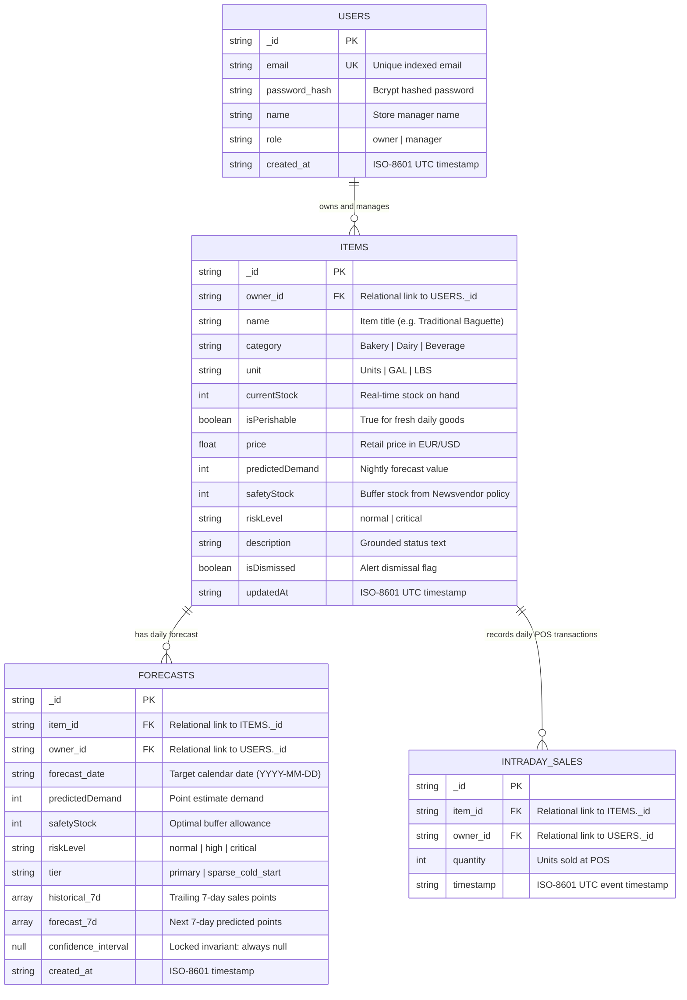
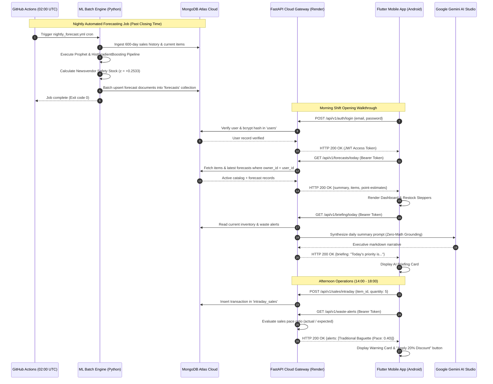
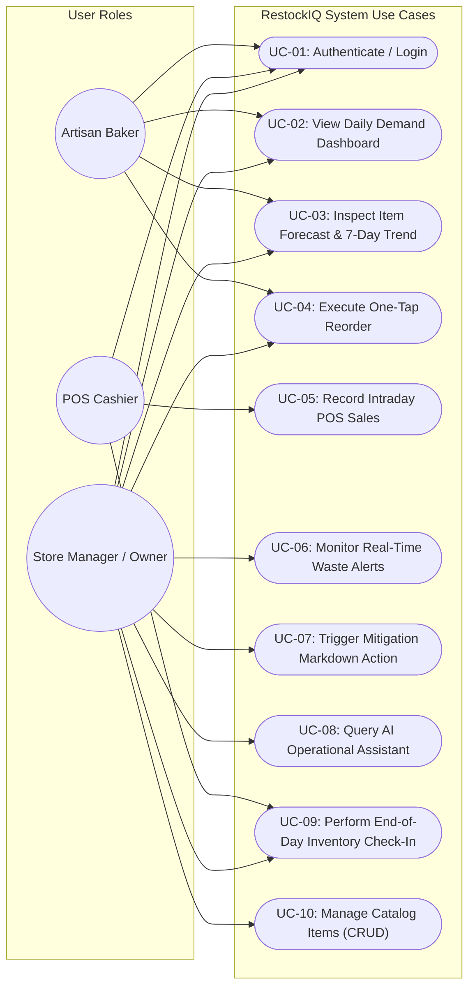
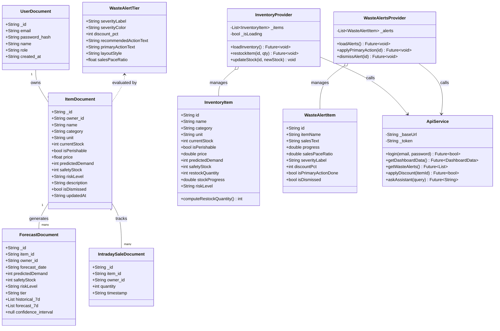

# RestockIQ: Architecture & Design Diagrams (UML / Mermaid)

This document provides formal, publication-ready UML and architectural diagrams generated directly from the verified RestockIQ codebase for inclusion in Chapter 3 (System Design & Architecture) of the Capstone Project Black Book.

---

## 1. System Architecture Diagram



---

## 2. Entity-Relationship (ER) & Collections Diagram



---

## 3. End-to-End System Sequence Diagram



---

## 4. Use Case Diagram



---

## 5. Detailed Class Diagram (Mapped from Actual Code Classes)



---

## 6. Activity Diagram: Waste Alert & Markdown Mitigation Flow

```mermaid
flowchart TD
    Start([POS Sale Logged]) --> ReadStock[Fetch Current Item Stock & Sales Count]
    ReadStock --> CheckPerish{Is Item Perishable?}
    
    CheckPerish -- No --> Ignore[No Waste Alert Needed; Return Normal]
    CheckPerish -- Yes --> CalcElapsed[Calculate Day Elapsed Fraction<br/>elapsed = (CurrentHour - 8) / 12]
    
    CalcElapsed --> ExpectedSales[Compute Expected Sales by Now<br/>expected = daily_forecast * elapsed]
    ExpectedSales --> CalcRatio[Compute Sales Pace Ratio<br/>ratio = actual_sold / expected]
    
    CalcRatio --> EvaluateThreshold{Evaluate Ratio}
    
    EvaluateThreshold -- "ratio >= 0.70" --> NormalState[Normal Velocity: Low Risk<br/>No Action Required]
    EvaluateThreshold -- "0.35 <= ratio < 0.70" --> LowPaceAlert[Trigger Moderate Waste Alert<br/>Assign Medium Markdown]
    EvaluateThreshold -- "ratio < 0.35" --> CriticalAlert[Trigger High-Risk Spoilage Alert<br/>Assign Steep Markdown / Bundle]
    
    LowPaceAlert --> PushNotification[Display Alert Card on Mobile Dashboard]
    CriticalAlert --> PushNotification
    
    PushNotification --> ManagerDecision{Store Manager Action}
    
    ManagerDecision -- "Tap Apply Discount" --> UpdatePrice[POST /api/v1/waste-alerts/:id/apply-discount<br/>Update POS Price in Atlas]
    ManagerDecision -- "Tap Dismiss" --> MarkDismiss[POST /api/v1/waste-alerts/:id/dismiss<br/>Set isDismissed = True]
    ManagerDecision -- "No Action" --> WaitNextShift[Hold until next hourly check]
    
    UpdatePrice --> SuccessSnackbar[Show 'Discount Applied' Confirmation]
    MarkDismiss --> RemoveCard[Card Removed from View]
    
    SuccessSnackbar --> End([Flow Complete])
    RemoveCard --> End
    NormalState --> End
    Ignore --> End
    WaitNextShift --> End
```
