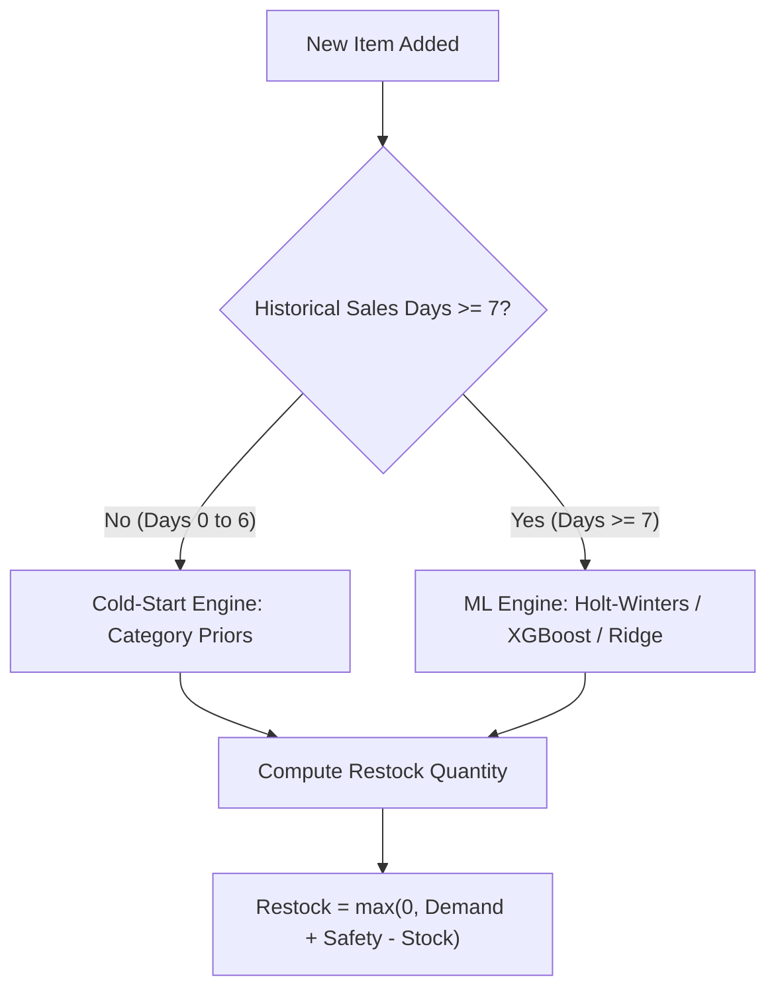

# RestockIQ - Complete App Behavior and Operational Guide

This guide provides a comprehensive, ground-truth reference for RestockIQ's architecture, workflows, mathematical forecasting engines, and edge-case behaviors as verified on physical hardware over USB.

---

## 1. Authentication & Onboarding Architecture

### 1.1 State-Driven Routing
RestockIQ determines user navigation based on a dual-state verification model:
1. **Unauthenticated**: User is directed to `Welcome Back` (`LoginScreen`), with immediate access to `RegisterScreen`.
2. **Authenticated (First Time / Onboarding Incomplete)**: If `profile.onboarding_completed == false`, the app navigates immediately to `TourScreen(isReplay: false)`. The user experiences the 7-step interactive walkthrough before setting up their store catalog.
3. **Authenticated (Active Store)**: If `profile.onboarding_completed == true`, the app directly opens `DashboardScreen` bound to `LiveRepository`.

### 1.2 Validation Rules
- **Email Validation**:
  - Client enforces regex `^[\w-\.]+@([\w-]+\.)+[\w-]{2,4}$`.
  - Backend enforces RFC compliant email parsing via Pydantic `EmailStr`. Reserved TLDs (e.g. `.test`, `.local`) trigger HTTP 422 Unprocessable Entity.
- **Password Validation**:
  - Minimum 8 characters required.
  - Failure to meet criteria blocks submission client-side with red inline error banners.
- **Duplicate Email Prevention**:
  - MongoDB unique index enforces unique emails. Attempting duplicate registration returns HTTP 409 Conflict (`Email already registered`).
- **Account Lockout Protection**:
  - 5 consecutive failed login attempts trigger an automatic account lockout.
  - The 5th and subsequent attempts return HTTP 401: `Invalid email or password. Account is temporarily locked. Please try again later.`.
  - The client displays both a card-level error container and a floating red SnackBar.

---

## 2. Interactive Tour (Demo Sandbox)

The interactive tour is an isolated simulator designed to demonstrate RestockIQ's capabilities using French bakery dataset replay without writing to production collections.

### 2.1 Fallback Resilience
If the cloud demo tenant fails or is cold (HTTP 500/503), the tour does **not** crash. It activates `SampleRepository` with an offline amber pill (`DEMO TOUR`) and continues to guide the user seamlessly through all 7 steps.

### 2.2 Tour Steps & Capabilities
- **Step 1 - Demand & Restock Formula**: Demonstrates Croissant demand calculation (Current Stock: 30, Predicted Demand: 80, Safety Stock: 40, Recommended Restock: +90).
- **Step 2 - Waste Mitigation**: Demonstrates alert triggering on perishable items (Whole Milk) with suggested bundle promotions.
- **Step 3 - Traditional Baguette Formula**: Dynamic formula: $\text{Restock} = \max(0, \text{Demand} + \text{Safety} - \text{Stock})$.
- **Step 4 - Intraday Tracking & Clock Simulation**: Allows the manager to simulate afternoon hours (14:30) to test sales pacing alerts.
- **Step 5 - Closing Count Review**: Displays sell-through percentages (Croissant 92%, Baguettes 78%, Milk 35%).
- **Step 6 - Executive AI Briefing**: Demonstrates Gemini-grounded natural language Q&A. Responds to inventory questions based strictly on catalog context without fabricating math.
- **Step 7 - Clean Slate Transition**: Prompts the user to start their real store, warning that tour demo fixtures will not carry over into live inventory.

---

## 3. Forecasting Engine & Mathematical Formulations

RestockIQ combines two forecasting engines depending on store data maturity:

### 3.1 Cold-Start Engine (Days 0 to 6)
When an item has fewer than 7 days of historical sales, time-series statistical models lack sufficient degrees of freedom. RestockIQ uses **Category Bayesian Priors**:
- **Bakery**: Base daily demand prior $\mu = 24.0\text{ units}$, Safety stock $= 7\text{ units}$.
- **Beverage**: Base daily demand prior $\mu = 18.0\text{ units}$, Safety stock $= 5\text{ units}$.
- **Dairy / Produce**: Category-specific standard consumption distributions.
- **Confidence Intervals**: 80% confidence interval computed via category standard deviation $\sigma$.

### 3.2 Mature ML Forecasting (Days 7+)
Once 7+ days of daily closing counts exist:
- Model evaluates Ridge Regression, Holt-Winters Exponential Smoothing, and LightGBM/XGBoost.
- Cross-validation selects the model with minimal MAPE (Mean Absolute Percentage Error).

### 3.3 The Core Restock Formula
For any target date $t$:
$$\text{Recommended Restock} = \max(0, \text{Predicted Demand}_t + \text{Safety Stock}_t - \text{Current Stock}_t)$$
- If the item is marked with a **Critical Waste Alert**, Restock is capped to `0` to prevent compounding expired inventory.

---

## 4. Daily Routines & Store Operations

RestockIQ guides store managers through three distinct operational check-ins:

### 4.1 Closing Count (End of Day)
- **Input**: Manager enters leftover units on shelf at close.
- **Client Validation**:
  - Leftover units cannot exceed available stock: $\text{Left} \le \text{Opening} + \text{Added}$.
  - Values exceeding available stock highlight in red: `Left (X) cannot exceed available (Y)`.
- **Accounting Split**:
  - $\text{Sold} = \text{Available} - \text{Left}$
  - **Perishable items**: Leftover units become **Waste**: $\text{Waste} = \text{Left}$.
  - **Non-perishable items**: Leftover units carry over into next day's opening stock: $\text{Carryover} = \text{Left}$, $\text{Waste} = 0$.
- **Learning Progression**: Each submitted closing count increments catalog history days ($0/7 \to 1/7 \to \dots \to 7/7$), unlocking full ML forecasting.

### 4.2 Mid-Day Pace Check (Intraday)
- Manager inputs remaining shelf counts during business hours.
- Engine calculates sales velocity:
  $$\text{Actual Velocity} = \frac{\text{Opening Stock} - \text{Remaining}}{\text{Elapsed Hours}}$$
  $$\text{Expected Velocity} = \frac{\text{Predicted Demand}}{\text{Total Store Hours}}$$
- If $\text{Pace Ratio} = \frac{\text{Actual Velocity}}{\text{Expected Velocity}} < 0.5$, a **Lagging Pace Alert** is generated, advising bundle promotions or discount tags before closing.

### 4.3 Yesterday Performance Review
- Aggregates yesterday's sell-through rate:
  $$\text{Sell-Through} = \frac{\text{Sold}}{\text{Available}} \times 100\%$$
- Thresholds:
  - **High**: $> 90\%$ (Risk of stockout)
  - **Normal**: $70\% - 90\%$ (Optimal balance)
  - **Low**: $35\% - 70\%$ (Slight overstock)
  - **Critical**: $< 35\%$ (Severe waste risk on perishables)
- If yesterday has no data (e.g. Day 1 store), UI displays graceful `no closing count recorded` with `no data` status chips without crashing.

---

## 5. Offline Resilience & Session Continuity

1. **Session Persistence**: JWT auth tokens and user profile documents are stored in secure local storage. Force-stopping or killing the app and relaunching immediately re-hydrates the active user session directly into `• LIVE` Dashboard in $< 2.5\text{s}$.
2. **Airplane Mode / Network Drop**:
   - When network disconnects, local providers serve the latest cached store state.
   - Live badge transitions gracefully to offline indicator.
   - When network is restored, background auto-reconnect synchronizes pending updates without requiring manual re-login.

