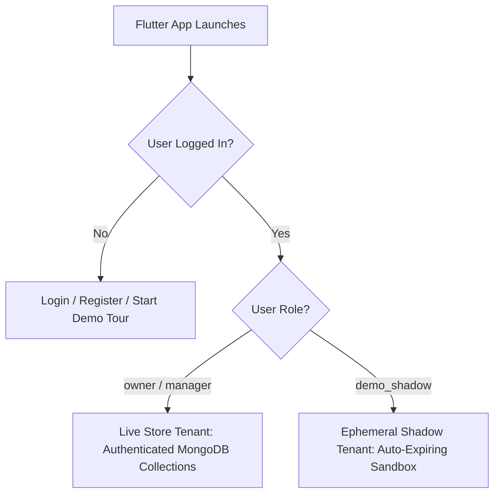
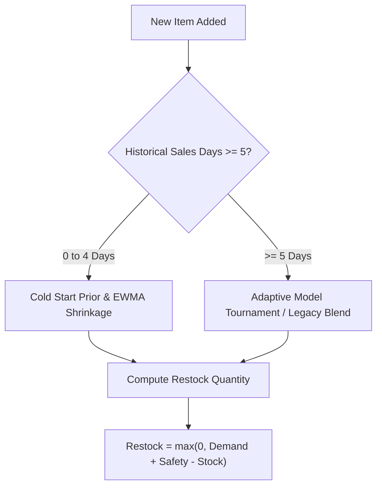

# RestockIQ App Behavior & Verification Guide

## 1. System Overview
RestockIQ is an AI-powered predictive inventory optimization platform designed specifically for artisan bakeries, cafes, and perishable retail businesses.

---

## 2. Real Store vs Demo Sandbox Architecture

- **Live Store Tenant**: Real business managers entering physical inventory counts. History is built through actual daily closing counts.
- **Demo Sandbox**: Ephemeral shadow tenant pre-populated with simulated reference catalog and data for evaluator testing. Never touches live user records.

---

## 3. Demand Forecasting & Inventory Optimization

RestockIQ delivers automated demand forecasts and safety stock recommendations based on real store data maturity:

### 3.1 Cold-Start & Early Traction
When an item has fewer than 5 days of historical sales:
- **Cold Start ($n = 0$)**: Evaluates category benchmark prior (e.g. Bakery $= 24.0\text{ units/day}$, Safety stock $= 6\text{ units}$).
- **Early Traction ($1 \le n < 5$)**: Blends Exponentially Weighted Moving Average (EWMA, $\alpha=0.5$) with category benchmark prior via empirical Bayesian shrinkage $w = \frac{n}{n + 1}$.
- **Point Estimates**: By design, point forecasts are generated; `confidence_interval` field is set to `null`.

### 3.2 Mature Forecasting ($n \ge 5$ Days)
Once 5+ days of daily closing counts exist:
- **Adaptive Mode (`FORECAST_MODE=adaptive`)**: Runs an automated per-store model tournament backtesting 5 candidate algorithms (`last`, `ewma`, `ma7`, `swd`, `blend`) over rolling historical windows. A candidate must achieve $\ge 5\%$ lower MAE than the robust 7-day average (`ma7`) to unseat it.
- **Legacy Mode (`FORECAST_MODE=legacy`)**: Uses TSB credibility shrinkage for days 1–27, and transitions to a 4-week same-weekday + 7-day rolling mean for days 28+.
- **Demo Replayed Stores**: Use reference GBDT models trained on bakery benchmark data.

### 3.3 The Core Restock Formula
For any target date $t$:
$$\text{Recommended Restock} = \max(0, \text{Predicted Demand}_t + \text{Safety Stock}_t - \text{Current Stock}_t)$$
- If the item is marked with an active **Critical Waste Alert**, restock is held to `0` to prevent compounding expired inventory.

---

## 4. Daily Routines & Store Operations

RestockIQ guides store managers through three distinct operational check-ins:

### 4.1 Closing Count (End of Day)
- **Input**: Manager enters leftover units on shelf at close.
- **Client Validation**:
  - Leftover units cannot exceed available stock: $\text{Left} \le \text{Opening} + \text{Added}$.
  - Values exceeding available stock highlight in red: `Left (X) cannot exceed available (Y)`.
- **Accounting Split**:
  - $\text{Sold} = \text{Available} - \text{Left}$
  - **Perishable items**: Leftover units become **Waste**: $\text{Waste} = \text{Left}$.
  - **Non-perishable items**: Leftover units carry over into next day's opening stock: $\text{Carryover} = \text{Left}$, $\text{Waste} = 0$.
- **Learning Progression**: Each submitted closing count increments catalog history days, advancing forecast accuracy.

### 4.2 Mid-Day Pace Check (Intraday)
- Manager inputs remaining shelf counts during business hours.
- Engine calculates sales velocity:
  $$\text{Actual Velocity} = \frac{\text{Opening Stock} - \text{Remaining}}{\text{Elapsed Hours}}$$
  $$\text{Expected Velocity} = \frac{\text{Predicted Demand}}{\text{Total Store Hours}}$$
  $$\text{Pace Ratio} = \frac{\text{Actual Velocity}}{\text{Expected Velocity}}$$
- **Pace Alert Severity Thresholds**:
  - **Critical Pace Alert (Red)**: $\text{Pace Ratio} < 0.35$ (Severe lag; urgent discount/bundling advised).
  - **Low Pace Alert (Amber)**: $0.35 \le \text{Pace Ratio} < 0.70$ (Moderate lag; monitor afternoon pace).
  - **Normal / High Pace**: $\text{Pace Ratio} \ge 0.70$ (On track for full sell-through).

### 4.3 Yesterday Performance Review
- Aggregates yesterday's sell-through rate:
  $$\text{Sell-Through} = \frac{\text{Sold}}{\text{Available}} \times 100\%$$
- Thresholds:
  - **High**: $> 90\%$ (Risk of stockout)
  - **Normal**: $70\% - 90\%$ (Optimal balance)
  - **Low**: $35\% - 70\%$ (Slight overstock)
  - **Critical**: $< 35\%$ (Severe waste risk on perishables)
- If yesterday has no data (e.g. Day 1 store), UI displays graceful `no closing count recorded` with `no data` status chips without crashing.

---

## 5. Offline Resilience & Session Continuity

1. **Session Persistence**: JWT auth tokens and user profile documents are stored in secure local storage (`SharedPreferences`). Killing the app and relaunching immediately re-hydrates the active user session directly into the Dashboard in $< 2.5\text{s}$.
2. **Airplane Mode / Network Drop**:
   - When network disconnects, local providers serve the latest cached store state.
   - Live badge transitions gracefully to offline indicator.
   - Network requests employ exponential backoff retries upon network restoration.
